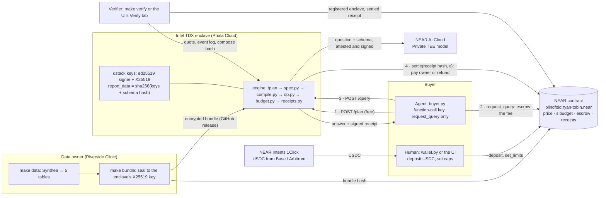

# Blindfold

[](https://github.com/ryan-tobin/blindfold/actions/workflows/tests.yml)

Blindfold is a private data room where AI agents pay per question for differentially private answers from encrypted data held in a TEE, with payments, limits and receipts on NEAR. **Answers, not data.**

A clinic encrypts its patient records so that only one audited program, running in an Intel TDX enclave, can open them. A buyer's agent asks in plain English and pays per answer in USDC. The enclave turns the question into a fixed-format query with a private model, adds calibrated noise, refuses anything that would single out a person, and signs a receipt that is settled on NEAR. The demo data is 10,000 synthetic patients, so no real person's data is involved.

- **Live UI:** https://ryan-tobin.github.io/blindfold/ (testnet by default; mainnet in the header). The testnet enclave stays running from Nov 14 through Nov 18, 2026; the mainnet one is started for demos.
- **Demo video:** _TBD (Nov 13)_
- **Try it locally in three commands:** [Quickstart](#quickstart), no keys and no wallet

## Tracks entered and why

- **Privacy & Private AI (primary):** the data never leaves the enclave unencrypted, every answer is differentially private with a public, on-chain privacy budget, and even the buyer's question stays private, planned inside the enclave by a Private TEE model on NEAR AI Cloud whose signature goes into the receipt.
- **Agent Economy:** agents buy answers with a function-call key that can only call `request_query`, inside per-question and daily caps the human sets. USDC comes in from Base or Arbitrum through NEAR Intents, the contract escrows each fee, and the owner is paid only when the enclave settles an answer.
- **AI Security & Defense:** an agent that tries to single out a patient is refused before it pays and once again inside the enclave, and the refusal is recorded on-chain with a refund. Repeating a question returns the same noise for free, so averaging attacks don't work, and anyone can verify a receipt down to the enclave's measured code, in the browser or with `make verify`.

## Quickstart

You need Python 3.11+ and curl. Nothing else, and no keys:

```bash
python3 -m venv .venv && . .venv/bin/activate && pip install -e "./engine[dev]"
make data-quick   # the 5 analytic tables, prebuilt (4 MB, SHA-256 checked)
make demo         # plan, answer, replay, refusal and receipt check, in one run (a few seconds)
```

`make data-quick` downloads the tables `make data` builds, checked against a pinned SHA-256. To build them yourself from Synthea instead, run `make data` (needs Java 17+ and 6 to 25 minutes). You get the same rows, so every number in this README matches either way; only the DuckDB file's bytes differ between builds, so the checksum pins the published file. The data is synthetic and anyone can regenerate it from the fixed seed; a real data owner would only ever publish the encrypted bundle.

Then, in the same virtualenv:

```bash
make test   # 233 engine tests + 13 agent tests, plus 19 contract tests if Rust is installed
make bench  # accuracy on 200 benchmark questions at ε 0.1, 0.2, 0.5 and 1 (about 10 s)
make ui     # the browser UI on http://localhost:5173 (Node 20+; ?net=local talks to make serve)
```

GitHub Actions runs these same steps on a clean Ubuntu machine on every push (`.github/workflows/tests.yml`).

### More commands

The other prerequisites are only for the parts that use them: Java 17+ for `make data`, [Rust](https://rustup.rs) for the contract tests (`contract/rust-toolchain.toml` installs Rust 1.93.0 and the wasm target on first use) and [cargo-near](https://github.com/near/cargo-near) 0.22 to build it, Docker for the simulated enclave, and Node 20+ for the UI.

```bash
make sql    # check the demo question and show the SQL it compiles to
make ask    # answer the demo question with differential-privacy noise
make serve  # start the engine's HTTP service on http://127.0.0.1:8000 (leave it running)
make query  # in a second terminal: ask the running service, get the answer and a signed receipt
make verify REQUEST=1  # check that receipt's signature and the enclave that signed it
make plan   # with make serve running: turn the demo question, in plain English, into a QuerySpec (free; no key needed for the 5 demo questions)
make buy BUYER=alice.testnet Q="How many patients have hypertension, by age band?"  # with make serve running: the buyer agent, local and unpaid
```

To run the engine in a simulated enclave instead, use Docker: `make up` (the first build compiles Phala's dstack simulator, 10–20 minutes), then the same `make query` and `make verify REQUEST=1`. Docker reads `CONTRACT_ID` from `.env`; leave it blank (or run `CONTRACT_ID= make up`) for this local run.

## What you should see

`make data-quick` ends with `data/riverside.duckdb ready: the 5 tables make data builds (SHA-256 9509ce8a… checked)`.

`make demo` starts the engine on a spare port with a fresh budget, runs six steps against it, and stops it. The noisy numbers and hashes change on every run; everything else should match:

```text
Engine on http://127.0.0.1:<port>: dev enclave, planner stub, privacy budget 10.0 of 10.0

[1/6] Plan a question in plain English (free)
      Q: What is the 30-day readmission rate for diabetic patients aged 65 and older, by sex?
      -> Rate of encounter_class inpatient and readmit_30d yes among patients · encounter_class inpatient · age_band 65-79, 80+ · condition_group diabetes · by sex · ε 1
      ε 1.0, spec hash 148530310325af34…, will refuse: no

[2/6] Ask it: a noisy answer with a 95% error bar and a signed receipt
      female                 9.0% ± 1.4
      male                   11.6% ± 1.4
      receipt #1, ε charged 1.0, ε left 9.0

[3/6] Ask the same question again: same noise, no ε spent (no averaging attack)
      female                 9.0% ± 1.4
      male                   11.6% ± 1.4
      receipt #2, replay of #1, ε charged 0.0

[4/6] Try to single out one patient
      Q: How many conditions does the 70-year-old woman in ZIP 606 who was admitted on March 3, 2026 have?
      the plan already says it will be refused: too_fine. Send it anyway:
      refused: rule 3 (too_fine), filter on 'admissions.admit_date': date ranges must cover at least 30 days
      ε charged 0.0

[5/6] Verify receipt #1: hash, enclave signature, attestation
receipt 1 (answered), hash 9498ee6b3d2ba6efa7bbba31e30e26a2ed67d323193cb35282f83300ebc719d2
✓ receipt hash matches its contents
✓ signature valid for ed25519:DzDj2AxQfWQvrwKtsKvGy8F6W1VfgtTMZMrh3hSbthth
! no model signature: the spec came from the offline stub or from the buyer
✓ signer is the engine's enclave key
✓ report_data = sha256(signer key + encryption key + schema hash)
! enclave mode: dev (no quote: not a TEE)
all checks passed

[6/6] The public privacy budget
      spent 1.0 of 10.0, 9.0 left

Done. The engine is stopped; this run's budget and receipts were in a temp folder.
```

What each step shows:

1. **Plan.** The plain-English question becomes a QuerySpec, shown in plain words with its ε, before anyone pays. Without `NEAR_AI_API_KEY` the offline stub plans the 5 demo questions; with a key it's a Private TEE model on NEAR AI Cloud.
2. **Answer.** The true rates are 10.7% (women, 22 of 205) and 12.0% (men, 23 of 191). The answer is within the ± bar about 95% of the time, and the receipt is signed by the enclave's key.
3. **Replay.** The same question, from another buyer, gets the stored noisy answer and costs no ε, so asking 1,000 times can't average the noise away.
4. **Refusal.** A question that narrows in on one patient is flagged at planning and refused by the engine (rule 3, `too_fine`), at no cost.
5. **Verify.** `verify/verify.py` recomputes the receipt hash, checks the ed25519 signature and the attestation's report_data. The two yellow `!` lines are expected locally: the stub has no model signature, and `make demo` runs in dev mode with no TDX quote. Against the real enclave the same verifier checks the Intel quote too ([Contract and enclave measurement](#contract-and-enclave-measurement)).
6. **Budget.** One answer spent ε 1.0 of Riverside's 10.

`make test` prints `233 passed` for the engine, `13 passed` for the buyer's scripts in `agent/`, then `test result: ok. 19 passed` for the contract, followed by an empty doc-test run (`0 passed`) (or a line saying the contract tests were skipped, without Rust). Before any data is downloaded or built, the engine part prints `211 passed, 22 skipped`, because the checks on the real tables need the database. The first contract run downloads Rust 1.93.0 and the crates, so it takes a few minutes.

`make bench` prints the table under [Accuracy](#accuracy-noisy-answers-against-the-truth), digit for digit, because the benchmark's noise is seeded.

### Building the data from Synthea

`make data` takes about 15–25 minutes the first time: it downloads Synthea (191 MB), writes about 1.2 GB of CSVs to `data/synthea/csv/`, then builds the five analytic tables and prints their row counts. Synthea runs with a fixed seed, reference and end date, and time zone (UTC), so you should get these exact numbers on any machine, on any day:

```text
Built .../data/riverside.duckdb
  patients         10,000 rows
  admissions      270,648 rows
  conditions        8,524 rows
  medications       5,402 rows
  labs            325,355 rows
```

The demo question is `datasets/riverside/examples/readmit_patients_diabetes_65plus_by_sex.json`: of diabetic patients aged 65+ with an inpatient stay, what share were readmitted within 30 days, by sex? It counts each patient once, at ε 1.0.

`make sql` checks it, prints the parameterized SQL it compiles to, and runs it. It prints the **true** answers (women 22 of 205, men 23 of 191). That's a developer check on the raw data; the engine never returns these.

`make ask` gives the answer a buyer would get: the same question with differential-privacy noise, a 95% error bar and small-cell suppression. The numbers change on every run, for example:

```text
"display": "10.7% ± 1.3"     (women; true 10.7%)
"display": "12.4% ± 1.4"     (men; true 12.0%)
```

`make ask TRIALS=500` (dev only) draws the noise 500 times and reports the typical error against the true values. At ε 1.0 the median error is about 0.3 percentage points and the ± bar holds the true value about 95% of the time.

To see a refusal instead, run `make sql SPEC=datasets/riverside/examples/attack_one_patient.json`: it prints the refusal as JSON and exits with code 2, so make adds `Error 2` at the end. That is the expected result.

`make serve` starts the engine as a web service. Open http://127.0.0.1:8000/docs for the interactive API docs. It has eight endpoints:

| Endpoint | What it does |
| --- | --- |
| `GET /schema` | The public schema: tables, columns, categories and the query rules |
| `GET /budget` | The privacy budget: total (10), spent, remaining, and whether the dataset is closed |
| `POST /plan` | `{"question": "..."}`: the QuerySpec it becomes, in plain words, with its ε and price, and whether the engine would refuse it. Free |
| `POST /query` | `{"buyer": "alice.testnet", "spec": {...}}` (or `{"request_id": 7, ...}` in chain mode): a noisy answer or a refusal, always with a signed receipt |
| `GET /receipt/{id}` | The receipt of an earlier request |
| `GET /attestation` | The enclave's mode, public keys, report_data and quote |
| `GET /info` | Mode, app id, compose hash, NEAR account, contract, and where the data came from |
| `POST /bundle` | Load the encrypted bundle from `BUNDLE_URL` now (if it wasn't ready at startup) |

With the service running, `make query` (in a second terminal) sends the demo question as `alice.testnet` and prints the answer and its receipt. The receipt shows `"epsilon_charged": 1.0` and `"epsilon_remaining": 9.0`. Run `make query` again and you get the exact same numbers back, with `"replay_of": 1` and `"epsilon_charged": 0.0`: a repeated question costs nothing and can't be averaged. `make query SPEC=datasets/riverside/examples/attack_one_patient.json` is refused (`too_fine`) and costs nothing. Every receipt is signed by the enclave's ed25519 key. `make verify REQUEST=1` checks it: the receipt hash, the signature, that the key is the engine's, and that the attestation binds the keys to the schema. Without Docker the engine runs in **dev** mode (a local key in `data/dev_enclave.key`, no quote), and the verifier marks it in yellow.

The budget, the replay cache and the receipts live in `data/state.sqlite`, so they survive a restart. `make reset` deletes that file to start the budget again at 10.

`make bench` scores the noise against the truth on 200 questions in about 10 seconds and prints the table under [Accuracy](#accuracy-noisy-answers-against-the-truth). With the canonical data its numbers match the README exactly, because the benchmark's noise is seeded.

### The enclave and the chain

`make up` runs the engine next to Phala's dstack simulator, which gives it the same API as a real Intel TDX enclave. The engine derives two keys from dstack (`engine/blindfold/enclave.py`): an ed25519 **signer** that signs every receipt and is also the enclave's own NEAR account (the implicit account named by its public key), and an X25519 **encryption** key the data owner encrypts the bundle to. It puts `sha256(signer key + encryption key + schema hash)` into the attestation quote's report_data, so the quote binds both keys and the schema to the code. In the simulator the quote is a fixed sample, so `/attestation` says `"simulated": true` and the verifier shows it in yellow.

With `CONTRACT_ID` set (in `.env` for Docker, or `make serve CONTRACT_ID=...`), the engine runs in **chain mode**:

1. The buyer calls `request_query(dataset_id, spec_hash, epsilon)` on the contract, which escrows the price and returns a request id.
2. The buyer sends `{"request_id": 7, "spec": {...}}` to `/query`. The engine reads the request on-chain. The spec is the proof of purchase: the chain shows only its hash, so a spec that doesn't hash to the paid `spec_hash` gets HTTP 409 and changes nothing (no receipt, no settle, nothing counted against the buyer). A stranger can't read someone else's answer or use up their request. If the hash matches but ε differs from what was reserved, the question is refused (rule 6, `spec_mismatch`) and refunded.
3. The engine answers or refuses, signs the receipt, and calls `settle` with the receipt hash, signed by its own account (`engine/blindfold/chain.py`, `engine/blindfold/near.py`). Answered pays the owner and charges ε; refused refunds the buyer. The answer is returned only after the request is settled as answered on-chain.

The engine reads `epsilon_total` and `epsilon_spent` from the contract and uses the larger of the contract's and its own ledger, so neither a restart nor a lost transaction can overspend. The total is also capped by `BLINDFOLD_EPSILON_TOTAL`, written into the measured compose file, so a lying RPC node can't raise it. If `settle` fails, the engine keeps the answer and returns an error; sending the same request id again settles it without charging ε twice. If the buyer calls `expire` first, the answer was never handed out, so the engine throws it away and gives its ε back (HTTP 410). The replay cache only replays answers whose request settled on-chain. A request that reserved more than the per-question cap of ε 1.0 can never be answered, so the engine closes it for anyone who asks, and the budget it held is free again.

`make register-enclave CONTRACT_ID=... ADMIN=...` funds the enclave's account with 1 NEAR for gas and registers it on the contract. `make pay CONTRACT_ID=... BUYER=...` pays for the demo question on-chain and asks the engine (the buyer's key comes from near-cli's legacy keychain). `make verify REQUEST=<id> CONTRACT_ID=...` then also checks that the enclave is the registered one and that the request was settled with this exact receipt hash.

### The encrypted bundle and the real enclave

The data reaches the enclave only as an encrypted **bundle** (`engine/blindfold/bundle.py`). `make bundle URL=<engine>` first checks the enclave's attestation (`engine/blindfold/attest.py`), then packs the five tables as Parquet in one archive and seals it to the enclave's X25519 key, writing `data/riverside.bundle`. With `CONTRACT_ID` and `OWNER` it also lists the bundle's SHA-256 on the contract (`update_dataset`). The ciphertext is safe to publish: only the enclave can open it.

The engine fetches the bundle from `BUNDLE_URL`, refuses it unless its SHA-256 is the one listed on-chain (or `BUNDLE_HASH` without a contract), decrypts it in memory, and loads it into an in-memory DuckDB. The Parquet files sit in RAM (tmpfs) only while DuckDB reads them, then DuckDB's file access is switched off for good. Until a bundle loads, the engine still serves `/attestation` (the owner needs its key first) and `/query` answers 503; `POST /bundle` retries.

To try it locally with the simulator: `make up`, then `make bundle URL=http://127.0.0.1:8000 ALLOW_SIM=1`, then restart with `BUNDLE_URL=/app/data/riverside.bundle BUNDLE_HASH=<the printed hash> docker compose up`.

The real enclave runs on Phala Cloud in an Intel TDX VM, from `docker-compose.tee.yml`. That file is measured into the quote, so it pins the engine image by digest, names the contract and the bundle URL, and takes no env vars or secrets. The image is built by GitHub Actions (`.github/workflows/engine-image.yml`) with a signed build provenance, so anyone can check it came from this repo:

```bash
gh attestation verify oci://ghcr.io/ryan-tobin/blindfold-engine@sha256:daa68ac28022351e847905d0aa8577e6b7fed1162293eb0d2a30fb17d7db32f7 --repo ryan-tobin/blindfold
```

Pointed at the real enclave, `make verify` checks the whole chain: the quote is signed by a genuine Intel TDX CPU (dcap-qvl, up to Intel's root CA, with Phala's PCCS for revocation lists and TCB status), report_data binds the keys and schema, the event log replays to the quote's RTMR0-3 (dstack 0.5.12 leaves the RTMR3 digests empty, so the verifier computes each one from its event), its compose hash is `sha256(app_compose)`, and app_compose holds this repo's `docker-compose.tee.yml` byte for byte. The OS image hash is in the quote too; the image itself is dstack's, which Phala's key service checks before releasing keys, and the verifier doesn't rebuild it.

### Plain English to QuerySpec

Buyers don't write QuerySpecs by hand. `POST /plan {"question": "..."}` turns a question into one, shows it in plain words with its ε and price, and says if the engine would refuse it, all before anyone pays (`engine/blindfold/planner.py`). With `NEAR_AI_API_KEY` set, the question goes from the enclave to a **Private TEE** model on NEAR AI Cloud (by default `z-ai/glm-5.3-flash`), over plain HTTPS with no SDK. The model sees only the public `schema.json`, the rules and 10 worked examples, and must reply with JSON at temperature 0. The engine's own validator checks that JSON. A malformed spec goes back to the model once with the error; after two failures the buyer is asked to rephrase. A spec the privacy rules would refuse is never sent back to be "fixed", so the model can't learn to widen a question until it passes: it comes back marked `will_refuse`.

Every planning call is checked. Before it, the engine fetches NEAR AI's attestation with a fresh nonce and checks that the model's report binds the nonce and the model's signing address. After it, the engine fetches the response signature and checks it covers the SHA-256 of the exact request and response bytes and recovers to that attested address (`engine/blindfold/ethsig.py`: keccak-256 and secp256k1 recovery, written from scratch). `/plan` returns a `plan_id`. When the buyer sends it with the same spec to `/query`, the signature goes into the receipt as `model_signature`, and `make verify` checks it. Without the `plan_id` the receipt has no model signature, so nobody can attach their own planning call to someone else's receipt. The engine only accepts the model's own attested key (`provider_tee`), and refuses an attestation whose report_data doesn't bind the key and the nonce. With `NEAR_AI_API_KEY` set, the verifier also confirms that NEAR AI still attests the key and checks the model's Intel quote. So one receipt shows that both the model and the engine ran in hardware enclaves.

The planner, not the model, picks ε when the question doesn't name one: 1.0 for rates and means, 0.5 for counts, sums and histograms (`PLAN_EPSILON` in `engine/blindfold/planner.py`, never above the schema's cap of 1.0). The prompt also asks for readmission rates per patient (each patient counts once) unless the question counts stays. One patient then moves the answer by at most 1 instead of up to 5, so the demo question gets ±1.3 points instead of ±11 to ±16. The tradeoff is budget: a rate question spends a tenth of Riverside's ε 10, so the dataset answers about 10 new rate questions before it closes. Repeats are free.

Without a key, `/plan` falls back to an offline stub that knows exactly the 5 demo questions (`engine/blindfold/planner_stub.py`), so local mode needs no keys. `make plan-bench` scores a model on 25 questions: the 5 demo questions plus 4 rewordings of each (`datasets/riverside/planner_questions.json`). See Benchmark results.

### Payments and the buyer agent

A buyer pays in USDC (Circle's native USDC on NEAR, 6 decimals). They deposit once into the contract and set two caps, then hand their agent a key that can do one thing: call `request_query`. The scripts in `agent/` run on the buyer's machine, never in the enclave, so changing them doesn't change the enclave image.

`agent/wallet.py` is the human side. Everything that signs goes through near-cli-rs with the buyer's full key from the legacy keychain (`~/.near-credentials`), prints the command first and asks before sending (`--yes` skips the question, `--dry-run` only prints):

```bash
python agent/wallet.py status       --buyer alice.ryan-tobin.testnet   # wallet, contract balance, caps, agent key (reads only)
python agent/wallet.py register     --buyer alice.ryan-tobin.testnet   # NEP-145 storage with USDC for the contract and the buyer, 0.00125 NEAR each, once
python agent/wallet.py deposit 2    --buyer alice.ryan-tobin.testnet   # ft_transfer_call into the contract
python agent/wallet.py limits 0.25 1 --buyer alice.ryan-tobin.testnet  # at most 0.25 USDC a question and 1 USDC a UTC day
python agent/wallet.py agent-key    --buyer alice.ryan-tobin.testnet   # a function-call key for request_query only
python agent/wallet.py revoke-agent --buyer alice.ryan-tobin.testnet   # delete that key
python agent/wallet.py withdraw 0.25 --buyer alice.ryan-tobin.testnet  # take USDC back out (buyers' change, owners' earnings)
```

`agent-key` makes an ed25519 key in `~/.blindfold/agent-keys/<network>/<account>.json` (chmod 600) and adds it to the account as a function-call key: receiver the Blindfold contract, method `request_query`, a NEAR gas allowance (0.25 NEAR by default) and no deposits. Because `set_limits` and `withdraw` need 1 yoctoNEAR attached, the agent can spend within the caps and can't touch anything else.

`agent/buyer.py` (`make buy`) is the agent. It refuses to run unless its key is exactly that kind of key. For each question it:

1. plans it with `POST /plan` (free) and prints the plan in plain words;
2. checks the dataset is open, the privacy budget left, the price against both caps and the balance, the same checks the contract makes, so a payment that would fail is never sent;
3. pays with `request_query`, signed by the agent key;
4. gets the answer from `POST /query`, then reads the request on-chain and checks it was settled with the same receipt hash.

Questions the engine would refuse are skipped and not paid for. `--goal "..."` (with `NEAR_AI_API_KEY`) asks a NEAR AI model for up to 3 questions that serve the goal; `--plan-only` plans and prices without paying. At the end it writes a report to `data/reports/` with every answer, price, transaction and receipt, and saves each receipt to `data/receipts/` for `make verify`.

```bash
make buy CONTRACT_ID=blindfold.ryan-tobin.testnet URL=<testnet enclave URL> BUYER=alice.ryan-tobin.testnet \
    Q="What is the 30-day readmission rate for diabetic patients aged 65 and older, by sex?"
make buy CONTRACT_ID=blindfold.ryan-tobin.testnet URL=<testnet enclave URL> BUYER=alice.ryan-tobin.testnet \
    GOAL="Is diabetes linked to readmissions in older patients?"
```

On testnet, `alice.ryan-tobin.testnet` paid for requests 3 and 4 this way, and the agent skipped an attack question without paying. Circle's testnet faucet only accepts 64-hex implicit accounts, so the testnet USDC came to an implicit account first and was sent on with `ft_transfer`.

### Funding from another chain with NEAR Intents

`agent/fund.py` brings USDC from Base or Arbitrum to a NEAR mainnet account through the [NEAR Intents 1Click API](https://docs.near-intents.org/). It never holds the buyer's keys: it gets a quote with a one-time deposit address, the buyer sends USDC to it from their own wallet, and the script watches until it lands.

```bash
python agent/fund.py quote --amount 1 --to you.near --refund-to 0xYourBaseWallet        # dry quote: fees and time, nothing moves
python agent/fund.py quote --amount 1 --to you.near --refund-to 0xYourBaseWallet --go   # real quote with a deposit address, then watch
python agent/fund.py status 0xDepositAddress --to you.near [--tx 0xYourBaseTxHash]      # watch an earlier deposit again
```

Before quoting it checks that the account exists and is registered with the USDC contract, because a transfer to an unregistered account would fail. A real quote is saved with 1Click's signature to `data/intents/<deposit address>.json`, in case anything needs to be disputed. Set `ONECLICK_API_KEY` (a Distribution Channel key from partners.near-intents.org) to avoid 1Click's extra 0.25% fee. Intents has no testnet, so this always moves real money.

Run on Nov 4, 2026: 1 USDC sent from Base landed as 0.999798 USDC in `ryan-tobin.near` about 2 minutes later ([NEAR transaction](https://nearblocks.io/txns/5YPrshVTBq2CNar6RKeWyEM85yNKYomd4e1S6VCeYtF5)). That USDC paid for the first mainnet question.

### The browser UI

The UI is hosted at https://ryan-tobin.github.io/blindfold/, built from `ui/` by `.github/workflows/pages.yml` on every push. `make ui` runs the same UI (`ui/`, React and Vite, plain CSS and hand-drawn SVG, no component library) on http://localhost:5173. The dropdown in the header picks the network: `testnet` (the default), `mainnet`, or `local` for `make serve` with nothing paid.

- **Dataset card.** Riverside's title, source, price and owner, whether the engine is online in a TDX enclave, and whether the `schema.json` the UI shows hashes to the `schema_hash` on-chain.
- **Privacy meter.** A ring from ε 10 down to 0, read from the contract's `get_dataset`, with ε held by questions being answered shown in amber. It drops as answers settle.
- **Ask.** Type a question or pick a demo one, then **Plan it (free)** shows the QuerySpec in plain words, its ε, its price, and which TEE model planned it. **Pay and ask** has the buyer's NEAR wallet (connected with [NEAR Connect](https://github.com/hot-dao/near-selector), for example Meteor Wallet) sign `request_query`. The engine then answers and settles, and the UI draws the answer as bars with 95% error bars, plus the receipt hash and links to the payment and settlement transactions. Before paying, it runs the same checks as the contract (balance, both caps, budget left) and explains why it won't pay if one fails. A question the engine would refuse can't be paid for, except in attack mode. **Verify this receipt** under the answer opens the Verify tab on it.
- **Attack mode.** A toggle on the Ask panel loads the "find this patient" question (a 70-year-old woman in ZIP 606 admitted on March 3) with its plan already made, since the planner can take over a minute on it. The plan is the planner's own spec for that question at ε 0.5 (`stub_spec` in `planner_questions.json`), hashed in the browser the way the engine hashes it. It is marked as one the engine will refuse (`too_fine`: a single admit date, where date ranges must cover at least 30 days). **Pay and try it** pays anyway, so the enclave signs the refusal, settles it on-chain, and the contract refunds the fee. Both show in the feed.
- **Verify.** Type a request id, or press **verify** on a feed row. The browser fetches the receipt and the enclave's `/attestation` and checks them itself, in three groups. *Signed by the enclave:* the receipt hash recomputed from canonical JSON, the ed25519 signature (WebCrypto), the signer is the attested key, and, for a question this browser asked, the answer is the one that was signed. *Running the registered code:* report_data binds the keys and the schema, the TDX quote carries it, the event log's RTMR3 digests and a replay of RTMR0–3 match the quote, the compose hash in the quote is the hash of `app_compose`, the deployed compose file is this repo's, and it is the compose hash registered on the contract and named in the receipt. *Recorded on NEAR:* the request settled with this receipt hash and status, the signer is the registered enclave, and the ε charged (or the refusal and its refund). Intel's signature over the quote needs Intel's collateral, and NEAR AI's signature needs secp256k1, so `make verify` checks those two (`ui/src/verify.js`, `ui/src/canon.js`).
- **Owner.** Each listing as the contract has it: owner, price, budget left and held, answered, refused and expired counts and earnings over the last 100 questions, the owner's withdrawable balance, and the schema and bundle hashes. With the owner's wallet connected it can set the price, pause or reopen new questions, and withdraw. **List a new dataset** calls `register_dataset`, with the schema hash defaulting to Riverside's `schema.json`; `make bundle` then gives the bundle hash to set.
- **Accuracy.** The `make bench` results from `docs/bench.json`: median error, the share of questions within 10%, and how often the 95% error bar holds the truth, for each ε, with a bar chart and a table by measure.
- **Feed.** The last 15 questions from the contract's `list_recent`, answered, refused (with the rule, refunded), pending or expired, refreshed every 8 seconds.

The UI reads the chain with plain JSON-RPC view calls to FastNEAR's public RPC and talks to the engine over HTTPS. The engine allows any origin to read its replies (CORS), since every endpoint is public and nothing uses cookies. Depositing and setting caps stay in `agent/wallet.py` for now. Run on Nov 4, 2026 in local mode, the demo question came back as women 9.8% ± 1.3, men 11.6% ± 1.4, and the hypertension count by age band as ± 6 per band.

## Architecture and data flow



1. **List.** The owner builds the five tables, checks the enclave's attestation, and encrypts them to the enclave's key (`owner/encrypt.py`). The ciphertext goes to a public GitHub release and its SHA-256 onto the contract. The enclave only loads a bundle whose hash the contract lists, and keeps it in memory.
2. **Fund.** The buyer brings USDC to NEAR from another chain with NEAR Intents (`agent/fund.py`), deposits it into the contract, sets a per-question and a daily cap, and gives the agent a key that can only call `request_query` (`agent/wallet.py`).
3. **Plan.** The agent sends the question to `/plan` inside the enclave. The enclave asks a Private TEE model on NEAR AI Cloud for a QuerySpec, checks the model's attestation and signature, and validates the spec against the public schema. Free.
4. **Pay.** The agent calls `request_query(dataset, spec_hash, ε)`. The contract checks the caps, the balance and the privacy budget, and escrows the fee.
5. **Answer.** The agent sends the spec and request id to `/query`. The engine checks the spec matches what was paid for, applies the refusal rules and the per-patient caps, runs it on DuckDB, adds discrete Laplace noise, suppresses small cells, and signs a receipt.
6. **Settle.** The enclave's own NEAR account calls `settle` with the receipt hash. An answer pays the owner and spends ε on-chain; a refusal refunds the buyer. A question nobody settles can be expired for a refund.
7. **Verify.** Anyone can check a receipt: its signature, that the signing key is bound into a genuine Intel TDX quote, that the quote's compose hash is this repo's `docker-compose.tee.yml` with the engine image pinned by digest, and that the contract registered that enclave and settled that exact receipt hash.

Where the code is: `engine/` runs in the enclave (FastAPI service, DP engine, keys, chain client), `contract/` is the NEAR contract (Rust, near-sdk-rs), `agent/` and `owner/` are scripts for the buyer and the data owner, `verify/` is the verifier, `ui/` is the browser UI, and `scripts/` builds the data and runs `make demo`.

## Privacy guarantees and how each is enforced

- **Only aggregate questions in a fixed format.** The engine accepts a QuerySpec (measure, table, filters, group-by, ε), never SQL. `engine/blindfold/spec.py` checks every name and value against `datasets/riverside/schema.json` and refuses anything else with a rule and a reason (`engine/blindfold/refuse.py`).
- **No SQL injection by construction.** `engine/blindfold/compile.py` builds SQL from a fixed template; table and column names come only from the schema, and every value is a `?` parameter.
- **One patient can move an answer only so far.** After filters, each patient keeps at most `max_rows_per_patient` rows (5 admissions, 5 lab results, …) before anything is counted, and every group-by cell is returned, including empty ones. `compile.py` reports the resulting sensitivity for the noise step.
- **No narrowing in on a person.** At most 2 group-by columns and 50 cells, at most 3 quasi-identifiers (sex, age band, ZIP3, county, admission and discharge dates) per question, and date ranges of at least 30 days. One filter per column, and a date range repeated in a rate's numerator must overlap the first by at least 30 days, so two windows can't be combined into a finer one.
- **Every answer is differentially private.** `engine/blindfold/dp.py` adds discrete Laplace noise with scale sensitivity / ε to every count, drawn exactly with whole numbers and fractions from the OS's secure random source (`secrets`), so there is no floating-point rounding leak. Group-by cells and a rate's yes/no counts are disjoint, so a whole answer costs its ε once. Sums and means clip each value to the schema bounds and split ε between the sum and the count.
- **Small groups are hidden.** A cell whose noisy count is below 20 is shown as `<20`.
- **Every answer has an error bar.** A 95% interval for the noise comes with each value.
- **A total privacy budget.** The dataset has a budget of ε 10. Every new answer spends its ε, and costs add up. Spending is kept in exact fractions, so 100 questions at 0.1 spend exactly 10. A question that needs more ε than is left is refused, and at zero the dataset closes to new questions (`engine/blindfold/budget.py`, `engine/blindfold/app.py`).
- **No averaging attack.** The same question asked again, by anyone, returns the stored noisy answer at no cost (the replay cache). Asking 1,000 times gives the same noise 1,000 times. Questions are matched on their canonical form, so rewording the JSON doesn't get fresh noise.
- **A rate limit.** At most 30 requests per buyer in any rolling hour, refusals and repeats included.
- **A receipt for every request.** Answered or refused, each request gets a receipt with the hash of the question, the hash of the answer, the ε charged and the ε left (`engine/blindfold/receipts.py`). Refusals cost no budget.
- **The question stays private too.** It goes to `/plan` inside the enclave, then to a Private TEE model on NEAR AI Cloud whose attestation and response signature the engine checks. The question is never stored or logged; only the model's signature is kept, in memory, to put in the receipt (`engine/blindfold/planner.py`, `engine/blindfold/app.py`). Planning is limited to 120 calls an hour (`PLAN_LIMIT_PER_HOUR`).
- **Payments, limits and the budget are public, on NEAR.** `contract/src/lib.rs` holds each dataset's price and privacy budget, escrows the fee for every question, and records ε spent and the receipt hash when the enclave settles. A refused question refunds the fee and is logged on-chain with its rule. Pending questions reserve their ε, so they can't overspend the budget together, and the contract won't let the enclave charge more ε than the buyer asked for.
- **An agent can buy answers but can't drain the wallet.** The buyer deposits USDC once and sets a per-question and a daily cap. Changing caps and withdrawing need 1 yoctoNEAR attached, which a NEAR function-call key can't attach, so an agent holding only a key for `request_query` can spend within the caps and nothing else.
- **Every receipt is signed inside the enclave.** The signer key is derived by dstack from the app's identity and never leaves the enclave. The quote binds it, the encryption key and the schema hash together, and the contract only accepts `settle` from that key's account, so a receipt hash on-chain means the enclave signed it (`engine/blindfold/enclave.py`, `engine/blindfold/receipts.py`, `verify/verify.py`).
- **The engine can only charge what was paid for.** In chain mode a question must match the spec hash and ε of a paid request (`engine/blindfold/app.py`). A spec with another hash is turned away and changes nothing. The right spec with the wrong ε is refused and refunded. A request is answered and settled once, and its answer is released only after it settles.

## Benchmark results

### Planner: plain English to QuerySpec

`make plan-bench` plans 25 questions (the 5 demo questions and 4 rewordings of each, `datasets/riverside/planner_questions.json`) through NEAR AI Cloud, with the attestation and signature checked on every call. A question is correct when its spec is the same canonical QuerySpec as an expected one (the 15 readmission, hypertension and heart-failure questions each accept either of two equivalent specs), or, for the 5 attack questions, when it is refused. Run on Nov 4 and 5, 2026:

| Private TEE model on NEAR AI Cloud | Prompt | Correct | Needed a retry | Median time |
| --- | --- | --- | --- | --- |
| `z-ai/glm-5.3-flash` (default) | current (per-patient rates) | 25/25 | 1 | 4.2 s |
| `z-ai/glm-5.3-flash` | Day 8 | 25/25 | 0 | 3.0 s |
| `deepseek-ai/DeepSeek-V4.1-Flash-1017` | Day 8 | 25/25 | 2 | 2.8 s |
| `Qwen/Qwen3.6-35B-A3B-FP8` | Day 8 | 25/25 | 1 | 4.8 s |
| `Qwen/Qwen3.8-27B` | Day 8 | dropped: over 120 s per question | | |

With the current prompt, `z-ai/glm-5.3-flash` planned 4 of the 5 readmission questions per patient. It planned the fifth ("what fraction of hospital admissions…") per stay, as the prompt asks when a question counts stays. Attack questions are the slowest to plan, up to 86 s.

On the Day 8 prompt, none of the 15 attack questions (5 per model) got an answer: the model refused 9 as asking about one person, and the engine refused 6 as `too_fine`. On the current prompt, the 5 attack questions were refused 2 times by the model and 3 times by the engine. `z-ai/glm-5.3` was not tested because its attestation didn't echo our nonce, so the engine won't use it.

### Accuracy: noisy answers against the truth

`make bench` (`engine/blindfold/bench.py`) builds 200 questions, 25 question shapes for each of the 8 condition groups: counts (overall, by sex, by age band, by ZIP3, 65+ by sex, sex by age band, 65+ on a statin), readmission rates per patient and per stay, the share of emergency visits, mean and total hospital days, drug classes (overall, by sex, 65+), and the mean HbA1c, LDL, systolic blood pressure and BMI (overall and by sex). It computes each true answer on the raw tables, outside any enclave, and writes them to `datasets/riverside/benchmark.jsonl`. Then, at each ε, it answers every question 20 times with the enclave's own noise code (`dp.answer`), charging no budget. Every cell a buyer would see is scored by its relative error, |noisy − true| / true, and by whether the truth is inside its 95% error bar. Cells under 20 people are shown as `<20`, so they aren't scored. True answers are rounded to 10 significant digits, because DuckDB's parallel sums can differ in the last digit between runs, so `make bench` rewrites `benchmark.jsonl` and `docs/bench.json` byte for byte. The benchmark seeds its random generator (seed 0) so the numbers reproduce exactly; the enclave itself draws noise from the OS's secure random source. Run on Nov 5, 2026:

| ε | Median error | 90% of cells within | Questions within 10% | Truth inside the 95% bar | Cells suppressed |
| --- | --- | --- | --- | --- | --- |
| 0.1 | 12.9% | 280.7% | 36% | 95.1% | 40.5% |
| 0.2 | **5.8%** | 100.0% | 52% | 94.8% | 43.0% |
| 0.5 | 2.3% | 38.4% | 66% | 96.0% | 45.2% |
| 1 | 1.0% | 14.6% | 73% | 95.6% | 46.4% |

Median error by measure:

| ε | count | histogram | mean | rate | sum |
| --- | --- | --- | --- | --- | --- |
| 0.1 | 7.0% | 25.2% | 13.1% | 24.4% | 77.5% |
| 0.2 | 3.1% | 11.7% | 7.3% | 12.0% | 44.6% |
| 0.5 | 0.9% | 3.7% | 3.6% | 4.5% | 18.1% |
| 1 | 0.2% | 1.8% | 1.8% | 2.2% | 8.9% |

What the numbers say:

- At ε 0.2, half of all answers land within 5.8% of the truth. At ε 1.0, the default for rates and means, half land within 1%.
- The 95% error bars are honest: the truth falls inside them 95% to 96% of the time at every ε. A buyer can take the ± at face value.
- The tail is small groups. A cell of 25 people with ± 30 noise is shown, and its relative error is large; the 90th-percentile column is mostly those cells. The ZIP3 and age-band shapes split rare conditions into many small cells, which is also why about 43% of cells are suppressed.
- Sums are the noisiest measure, since one patient can move a total by up to 150 hospital days (5 stays × 30 days). Means and rates over the same rows are far tighter.

The full per-question results are in `data/bench.json`, and the UI's Accuracy tab charts `docs/bench.json`. `make bench EPS=0.2 TRIALS=100` runs other settings.

## Tests

`make test` runs the unit tests. GitHub Actions (`.github/workflows/tests.yml`) runs the whole Quickstart on a clean Ubuntu machine on every push: install, `make data-quick`, `make test` (all three suites), `make demo` and `make bench`, and builds the UI.

- `engine/tests/test_load.py` (30): table schemas, identifier removal, `readmit_30d`, category values and lab bounds.
- `engine/tests/test_spec.py` (45): valid QuerySpecs pass and normalise to one canonical form; 33 bad specs are each refused with the right rule and reason.
- `engine/tests/test_compile.py` (22): exact answers on a hand-made database, the per-patient cap, empty cells, clipping, parameterized SQL, and runs on the real tables.
- `engine/tests/test_dp.py` (36): chi-square tests of the noise sampler against the exact distribution, its mean and variance, exact 95% error bars and their coverage, the noise scale for each measure, suppression, clipping, and noisy answers on the real tables.
- `engine/tests/test_budget.py` (8): exact budget sums, the replay cache, the rate-limit counter, state that survives a restart, rollback on failure, and receipt hashes.
- `engine/tests/test_app.py` (17): the HTTP service end to end: answers with receipts, CORS for the browser UI, free identical replays, the averaging attack, a refusal for each rule, the budget running out, the rate limit, a restart, and the demo question on the real tables.
- `engine/tests/test_enclave.py` (14): keys from a fake dstack agent over a unix socket and HTTP, report_data in the quote, dev-mode keys, and signed receipts that break when any field changes.
- `engine/tests/test_chain.py` (15): chain mode against a fake contract: paid questions settle, replays cost no ε, mismatched or bad specs are refused and refunded, a request is answered once, a failed settle retries for free, the budget follows the contract, plus NEAR transaction bytes checked against py-near and base58.
- `engine/tests/test_bundle.py` (10): bundle round trip with every row and type intact, no file access after loading, fresh ciphertext that reveals nothing, the wrong hash, key, schema or archive entries refused, an engine that starts without data and loads the bundle later, chain mode loading only the listed bundle, and the real tables.
- `engine/tests/test_attest.py` (11): a made-up TDX quote and event log: every check passes, the compose file named in the label, dstack's digest formula, digests computed when dstack leaves them empty, a forged event log, a different compose file, keys not in the quote, operator env vars, the NEAR AI key as the one allowed secret, and simulated or dev enclaves shown as warnings.
- `engine/tests/test_planner.py` (18): the planner against a fake NEAR AI server that signs with a real secp256k1 key: a checked plan end to end, one retry for bad JSON, rephrase after two failures, privacy refusals never retried, model refusals, a missing nonce, the wrong signer, a signature over other bytes, a late signature, prompt examples kept apart from the test questions, the planner's ε defaults, per-patient readmission rates in the prompt, the stub, `/plan`, its rate limit, and the model signature in the receipt.
- `engine/tests/test_bench.py` (3): the 200 benchmark questions are valid, distinct and cover every measure, and a short scoring run on the real tables.
- `engine/tests/test_ethsig.py` (4): keccak-256 and Ethereum signature recovery against values from eth-account.
- `agent/tests/test_agent.py` (13): USDC and NEAR amounts to and from text, agent keys that are refused (full access, the wrong contract, other methods, not on the account), the pre-payment checks for each cap, the balance and the budget, the 1Click quote body, and the report.
- `contract/src/tests.rs` (19): answered questions pay the owner and spend ε; refusals refund and cost nothing; a free replay; only the enclave settles, once, and never for more ε than requested; per-question and daily caps and the daily reset; an agent key can't raise its caps; pending questions reserve the budget; closed datasets; owner-only updates; expiry refunds; USDC-only deposits; unique dataset ids; the recent-queries feed.

## Contract and enclave measurement

The same contract runs on two networks, each with its own TDX enclave on Phala Cloud:

| | Testnet (demo fallback) | Mainnet (real USDC) |
| --- | --- | --- |
| Contract | [`blindfold.ryan-tobin.testnet`](https://testnet.nearblocks.io/address/blindfold.ryan-tobin.testnet) | [`blindfold.ryan-tobin.near`](https://nearblocks.io/address/blindfold.ryan-tobin.near) |
| Code hash | `E6cjptwZoGVmyhaxjL2bJ8ScUJeNipJK5sjAYebC82Hd` | `E6cjptwZoGVmyhaxjL2bJ8ScUJeNipJK5sjAYebC82Hd` (same wasm) |
| USDC | Circle's testnet USDC `3e2210e1…b8af` | Circle's USDC `17208628…33a1` |
| Riverside price | 0.25 USDC | 0.05 USDC |
| Enclave compose file | `docker-compose.tee.yml` | `docker-compose.mainnet.yml` |

Build the contract with `make contract`; cargo-near prints the wasm's SHA-256. The mainnet contract was deployed in [this transaction](https://nearblocks.io/txns/8XZ2zLKNjTtJJcWPt63FSZm1J2ELZf9PZAqM9QYxgSJE), with `ryan-tobin.near` as admin and an expiry of 1000 blocks.

| Method | Who calls it | What it does |
| --- | --- | --- |
| `new(admin, usdc_contract, expiry_blocks)` | once, at deploy | Sets the admin, the USDC token and how long a question can stay unsettled |
| `register_enclave(...)` | admin | Records the enclave's account, public keys, compose hash and quote hash (`make register-enclave`) |
| `register_dataset(id, schema_hash, bundle_hash, price, epsilon_total)` | data owner | Lists a dataset (`make register`) |
| `update_dataset(id, bundle_hash?, price?, active?)` | data owner | Sets the bundle hash, price, or closes the dataset. The budget can't change |
| `ft_on_transfer` | USDC, after the buyer's `ft_transfer_call` with `{"action":"deposit"}` | Credits the buyer |
| `set_limits(per_query_max, daily_max)` | buyer, full key, 1 yoctoNEAR | Agent spending caps |
| `request_query(dataset_id, spec_hash, epsilon)` | buyer's agent, function-call key | Checks caps, balance and budget, escrows the price, returns the request id |
| `settle(request_id, status, receipt_hash, epsilon_charged, refusal?)` | enclave account only | Answered pays the owner and spends ε; refused refunds |
| `expire(request_id)` | anyone, after `expiry_blocks` | Refunds a question nobody settled |
| `withdraw(amount)` | buyer or owner, 1 yoctoNEAR | Sends USDC out; puts it back if the transfer fails |
| `get_config`, `get_dataset`, `list_datasets`, `get_enclave`, `get_request`, `get_balance`, `list_recent` | anyone | Views |

Units: amounts are USDC's smallest unit (6 decimals, so $0.25 = `"250000"`) and ε is in millionths (1.0 = `1000000`), so the budget adds up exactly. Every change emits a NEP-297 event (`EVENT_JSON:{"standard":"blindfold",...}`).

Both enclaves run the same engine image, on Phala Cloud (Intel TDX, dstack 0.5.12, production OS image). Both compose files pass `NEAR_AI_API_KEY` as Phala's encrypted secret, the one secret the verifier allows:

| | Testnet enclave | Mainnet enclave |
| --- | --- | --- |
| URL (started for demos) | `https://87eb46e50a2a931b1f84dfeff6cb89bf77e9cff0-8000.dstack-pha-prod5.phala.network` | `https://ad57f4701c05bfdc2fe85c8afbaf8d046499a8d5-8000.dstack-pha-prod9.phala.network` |
| App id | `87eb46e50a2a931b1f84dfeff6cb89bf77e9cff0` | `ad57f4701c05bfdc2fe85c8afbaf8d046499a8d5` |
| Compose hash (registered on-chain) | `978b427e97573d4b…` (security-review image; was `91b52075…`, Day 10) | `bfd55c850494dd29…` (security-review image; was `8380732b…`, Day 10) |
| Engine image | `ghcr.io/ryan-tobin/blindfold-engine@sha256:daa68ac28022351e847905d0aa8577e6b7fed1162293eb0d2a30fb17d7db32f7` | the same |
| Enclave NEAR account | `b654d7e23d33e9bcc3096295ee4c85877f9e6c6dfc5b0f02960dd263dba91146` | `e637acc95c667ca5cfc7806a1d1459f7ece3dbe0dd26ed92403f0b48cec9bd6d` |
| Signer key | `ed25519:DGkEji4hQLxUYbDCYKFA5RwMJ8wfAjWKaREnwX6TpbuX` | `ed25519:GVg1ZbpCZDLUirwVcBtvXMezeJEo62gfKtK9PVzDHYdA` |
| Quote hash (registered on-chain) | `6b53eae72a172735c5904e48fd72f1ddaebc4b255d78391a3df171e4cc3d5f0e` | `065fac1c72344f60e3a3b7224005237ae41a0975a3403c232f5e70bc81cd46d3` |
| Encrypted bundle | [`riverside-v1`](https://github.com/ryan-tobin/blindfold/releases/tag/riverside-v1), SHA-256 `f67024c6e0678a34f02b1b0bc99ff9d796169ba9fc343fd3dfab211211b039ce` | [`riverside-mainnet-v1`](https://github.com/ryan-tobin/blindfold/releases/tag/riverside-mainnet-v1), SHA-256 `5a094f8d205aafa5c95d940886234b20cc155607ecf8442847f1443d7f2252c0` |

The mainnet enclave is a separate Phala app, so the key service gave it its own keys, and the owner encrypted a second bundle to them. Check the engine image came from this repo:

```bash
gh attestation verify oci://ghcr.io/ryan-tobin/blindfold-engine@sha256:daa68ac28022351e847905d0aa8577e6b7fed1162293eb0d2a30fb17d7db32f7 --repo ryan-tobin/blindfold
```

Check them yourself while they're running:

```bash
make verify REQUEST=3 CONTRACT_ID=blindfold.ryan-tobin.testnet URL=<testnet URL>
make verify REQUEST=0 CONTRACT_ID=blindfold.ryan-tobin.near NEAR_NETWORK=mainnet URL=<mainnet URL> COMPOSE=docker-compose.mainnet.yml
```

Testnet request 3 was paid by the buyer agent and answered and settled inside the enclave; every check passes. Mainnet request 0 is the first question paid with real USDC: `ryan-tobin.near` deposited 0.9 of the bridged USDC, set caps of 0.05 a question and 0.5 a day, and its agent key paid 0.05 USDC in [this transaction](https://nearblocks.io/txns/GiyUrmw7F69j9tiXFgoeJvFAEtk2MF7YBvu9TWXF2ZDq). Its receipt hash is `05a6f0f9e1d9f0070fec1553fac35a2e5480df775d7978e3e726b5e93e679837`, and all 24 checks pass. The Day 7 testnet run (request 2, settled in [this transaction](https://testnet.nearblocks.io/txns/8B2Aape5LfR7dQ3Gih3Wj76zDehCxPGVpJ3bDdqqBxbA)) was signed by the same testnet enclave key under the earlier compose hash `b6f5b259…b583`. Requests answered before the Nov 6 security-review upgrade name their own compose hashes (`91b52075…` and `2df57d50…` testnet, `8380732b…` and `a12ccebe…` mainnet), so `make verify` on them now shows the compose check in yellow: the enclaves have since been upgraded and re-registered under the security-review image, with the same keys.

## Built during the hackathon

Everything in this repository was written during NEAR HACKATHON. The first commit was made on Nov 1, 2026, inside the build window that opened with the announcement on Oct 19, 2026, and there is no code from before it. That is why there is no `pre-hackathon` tag. The final submitted state is tagged `hackathon-submission`.

## Third-party code and AI assistance

_Kept up to date as the build goes._

| What | Used for | License |
| --- | --- | --- |
| [Synthea](https://github.com/synthetichealth/synthea) v4.0.0 | Generates the synthetic patients. Downloaded at build time by `scripts/generate_data.sh`, not vendored | Apache 2.0 |
| [DuckDB](https://duckdb.org/) (Python package) | Analytic tables and queries | MIT |
| [pydantic](https://docs.pydantic.dev/) | Checks the shape of incoming QuerySpecs and requests | MIT |
| [FastAPI](https://fastapi.tiangolo.com/) and [Starlette](https://starlette.dev/) | The engine's HTTP service and its docs page | MIT, BSD-3-Clause |
| [Uvicorn](https://uvicorn.dev/) | Runs the HTTP service | BSD-3-Clause |
| [httpx2](https://github.com/pydantic/httpx2) (tests only) | FastAPI's test client needs it | BSD-3-Clause |
| [PyNaCl](https://github.com/pyca/pynacl) 1.6.2 | ed25519 receipt and transaction signatures, X25519 keys | Apache 2.0 |
| [dstack](https://github.com/Dstack-TEE/dstack) v0.6.1 simulator | The simulated enclave. Built from source by `docker/simulator/Dockerfile`, adapted from dstack's own simulator Dockerfile | Apache 2.0 |
| [dcap-qvl](https://github.com/Phala-Network/dcap-qvl) 0.7.0 | Checks Intel TDX quotes up to Intel's root CA (`engine/blindfold/attest.py`, dev and verify only) | Apache 2.0 |
| [Phala Cloud](https://phala.com/) with dstack 0.5.12 | Runs the real enclave: the TDX VM, its OS image and its key service (KMS) | service; dstack is Apache 2.0 |
| GitHub Actions (`actions/checkout`, `docker/*-action`, `actions/attest-build-provenance`) | Builds and signs the engine image | MIT or Apache 2.0 |
| [pytest](https://pytest.org/) | Tests | MIT |
| GitHub Actions (`actions/setup-python`, `actions/setup-node`, `actions/upload-pages-artifact`, `actions/deploy-pages`) | Runs the Quickstart on every push and publishes the UI to GitHub Pages | MIT |
| [Mermaid](https://mermaid.js.org/) (rendered by GitHub) | The architecture diagram in this README | MIT |
| [near-sdk-rs](https://github.com/near/near-sdk-rs) 5.29.1 | The NEAR contract | MIT or Apache 2.0 |
| [cargo-near](https://github.com/near/cargo-near) 0.22.0 | Builds the contract; project layout from `cargo near new` | MIT or Apache 2.0 |
| [near-cli-rs](https://github.com/near/near-cli-rs) 0.30.1 | Creates accounts, deploys, and signs calls from `owner/register.py` | MIT or Apache 2.0 |
| [NEAR Intents 1Click API](https://docs.near-intents.org/) | Bridges USDC from Base or Arbitrum to NEAR (`agent/fund.py`), called over plain HTTPS | service |
| [Circle USDC](https://www.circle.com/usdc) on NEAR | The payment token, testnet and mainnet | service |
| [NEAR AI Cloud](https://docs.near.ai/cloud/) | Private TEE model inference for `/plan`, with attestation and response signatures, called over plain HTTPS | service |
| [React](https://react.dev/) 19.3.1 and [Vite](https://vite.dev/) 8.3.4 with `@vitejs/plugin-react` 6.1.2 | The browser UI | MIT |
| [NEAR Connect](https://github.com/hot-dao/near-selector) (`@hot-labs/near-connect`) 0.11.4 | Connects the buyer's NEAR wallet in the UI and has it sign `request_query` | MIT |
| [FastNEAR](https://fastnear.com/) public RPC | The UI's and scripts' view calls and transactions | service |
| Python standard library | Everything else in the engine, including SQLite for the budget ledger | PSF |
| Claude (Anthropic), via Claude Code | AI assistance: project brief, planning, and docs | n/a |

## Known limits and what's next

- All data is synthetic (Synthea). No real person's data is used, even for testing.
- `make data-quick` downloads the plaintext tables from a GitHub release so a fresh clone runs in seconds. That is only fine because the data is synthetic and `make data` rebuilds the same file from a fixed seed; a real owner publishes only the encrypted bundle.
- `make demo` runs the engine in dev mode (a local key, no TDX quote) with the offline planner stub. The real enclave, NEAR AI planner and payments are shown on testnet and mainnet (see Contract and enclave measurement).
- Synthea has no ZIP code for some towns; those patients get `zip3 = "unknown"`.
- Contribution caps trade accuracy for privacy: a patient with more than 5 matching admissions or lab results counts only 5 (a fixed pseudo-random pick), so totals over heavy users are lower than the raw data. The benchmark measures this.
- Depression and heart failure are rare in Synthea's living population (well under 1% of patients), so most questions about them will be suppressed as small cells.
- Error bars cover the noise only, not sampling error. For rates and means they use a standard approximation; the tests check they hold the true value about 95% of the time.
- `readmit_30d` near the end of the data (after Oct 1, 2026) can miss readmissions that happen after the data ends.
- The simulated enclave's keys come from the simulator's public sample key file, so anyone can derive them, so it only ever runs locally.
- Phala's key service (KMS) derives the enclave's keys from its app id. Redeploying the same app keeps them; a new app gets new keys, and the owner re-encrypts the bundle (`make bundle`).
- Without `CONTRACT_ID` the engine runs in local mode: the buyer in `/query` is a name the caller types and nobody pays. With a contract, buyers pay in USDC from a prepaid balance (see Payments and the buyer agent).
- The agent's key is only as safe as the file it lives in (`~/.blindfold/agent-keys`, chmod 600). Whoever holds it can spend up to the caps, and burn its NEAR gas allowance, until the buyer runs `revoke-agent`.
- Planned questions now default to ε 1.0 (rates, means) or 0.5 (counts, sums, histograms), for usable error bars. That spends Riverside's budget of 10 in about 10 to 20 new questions; a real owner would set a larger budget or a lower default.
- The benchmark measures the noise and the contribution caps, against the truth on the same tables. It doesn't measure the planner; `make plan-bench` does that.
- The browser's Verify tab doesn't check Intel's signature on the quote or NEAR AI's signature on the plan; `make verify` does both. A receipt from before an upgrade names its own compose hash, so the "registered compose hash" check is red for it, by design.
- The UI has no automated tests; its wallet flow is checked by hand. Its receipt hashing and enclave checks were compared against the Python verifier on a made-up quote and on the live testnet enclave. Deposits and caps are set with `agent/wallet.py`, not in the UI yet.
- To keep the cost down (about $0.06 an hour each), the testnet enclave runs from Nov 14 through Nov 18, 2026 for judging, and the mainnet one is started only for demos. While one is stopped, its contract still takes questions, and `expire` refunds any that nobody settles.
- NEAR Intents has no testnet, so `agent/fund.py` only runs on mainnet with real money. On testnet the USDC comes from Circle's faucet.
- Trust model: the contract doesn't check the Intel TDX quote itself, which is too heavy for a contract. It trusts one registered enclave account, whose key exists only inside the enclave, and stores the quote hash so anyone can check it off-chain.
- Trust in Phala: the enclave's keys come from Phala's key service (KMS), which only releases them to a VM whose quote and compose hash it accepts, and the OS image is dstack's. The verifier checks the OS image hash is in the quote but doesn't rebuild the image. A KMS run on-chain (dstack supports one on Base) would remove that trust.
- The contract account pays NEAR storage for every question it records (a few hundred bytes each).
- The planner can misread a question. That is why `/plan` shows the spec in plain words before paying, and why the engine re-checks every spec. `make plan-bench` measures how often it is right.
- Security review (Nov 5, 2026): an audit with Cloudflare's security-audit tool and Claude Code found 19 issues; the fixes are in the engine, verifier, agent and UI. What remains:
  - The spec is the proof of purchase. Someone who guesses a common spec (a demo question, say) can read that answer by request id without paying. They could also buy the same replay for the price, so they learn nothing new. Receipts are public too (verifying needs them), and a receipt's `answer_hash` lets someone confirm a guess of a small answer. A NEP-413 signed request from the buyer's key would close both.
  - Any buyer can reserve up to ε 1.0 per request. Many requests can hold the budget until they expire (1000 blocks, about 17 minutes), at the cost of gas, with the price escrowed and refunded. A per-buyer cap on pending ε needs a contract change.
  - The enclave reads payments and settle results through one NEAR RPC node (FastNEAR). A malicious node could make it answer unpaid requests, though never past the budget cap in the compose file. NEAR light-client proofs would remove this trust.
  - `request_query` has no maximum-price argument. The UI reads the price again right before the wallet signs and stops if it changed, and the buyer's `per_query_max` caps the cost of any change after that.
  - `/plan` allows 120 questions an hour across all callers, so one caller can use it up. Buyers can still send a spec directly. Per-caller limits need the caller's IP, which Phala's gateway doesn't reliably pass on.
  - The UI runs on `ryan-tobin.github.io`, which every GitHub Pages site of that account shares, along with its browser storage (the wallet state). Only the account owner can publish there.
  - `verify/measurements.json` pins MRTD, RTMR0-2 and the pre-launch script hash to what our two enclaves report. That catches any change, but the values aren't rebuilt from dstack's source here.
  - The enclave image installs `engine/requirements.lock`: every package pinned by version and SHA-256 (`make lock`).
- The engine checks NEAR AI's attestation nonce and signature on every call, but not the model's Intel and NVIDIA quotes (too slow per question). `make verify` checks the Intel quote with `NEAR_AI_API_KEY` set; the NVIDIA GPU evidence is passed to the buyer in `/plan`'s `evidence` but not yet checked.

## License

MIT. See [LICENSE](LICENSE).